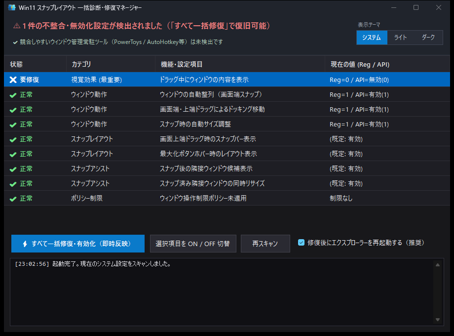
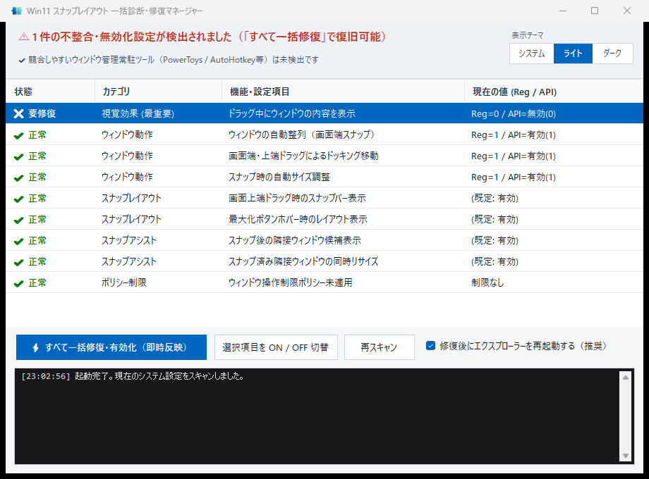

# Win11SnapAllInOne (Win11 スナップレイアウト 一括診断・修復マネージャー)

**Windows 11 のスナップレイアウト・画面端スナップ・ドラッグ視覚効果の不整合を瞬時に診断し、ワンクリックで一括修復するスタンドアロンツール**

[-0078D4?style=flat-square)](https://github.com/777Labs/Win11SnapAllInOne)

[📥 最新版をダウンロード (Releases)](https://github.com/777Labs/Win11SnapAllInOne/releases/latest)

---

## 📸 スクリーンショット

**ダークモード（システム連動 / ダーク）**

**ライトモード**

---

## ✨ 主な特徴

- 🚀 **完全スタンドアロン・ポータブル設計**:
  - インストール不要のポータブル設計。単一の実行ファイル（`Win11SnapAllInOne.exe`）だけでどの Windows 11 PC でも即座に起動します。
- 🔍 **レジストリ & Win32 API 実効値の同時スキャン**:
  - レジストリ値だけでなく `SystemParametersInfo` API の実効値まで一括診断し、設定の不整合や無効化されている項目を赤色ハイライトで表示します。
- ⚡ **ワンクリック一括修復・即時反映**:
  - レジストリの修復、Win32 API（`SPIF_UPDATEINIFILE | SPIF_SENDCHANGE`）の適用、`WM_SETTINGCHANGE` ブロードキャスト、およびエクスプローラー（`explorer.exe`）の再起動までを一括で実行します。
- 🎛️ **個別項目の ON / OFF 切替・再スキャン**:
  - 一覧の行をダブルクリック、または「選択項目を ON / OFF 切替」ボタンで項目ごとの状態切り替えに対応しています（ポリシー制限項目は一括修復ボタンから解除を実行します）。
- 🎨 **ダークモード対応（システム / ライト / ダーク）**:
  - 画面右上の「表示テーマ」スイッチから「システム」「ライト」「ダーク」をいつでも切り替え可能。「システム」選択時は Windows 11 のアプリモード設定に連動してリアルタイムに追従します。
- 🛡️ **競合しやすい常駐ツールの自動検出**:
  - 画面端ドラッグ判定に干渉する可能性がある常駐プロセス（`PowerToys` / `PowerToys.FancyZones` / `AutoHotkey` / `DisplayFusion` / `AquaSnap`）の稼働を起動時・再スキャン時に自動確認します。
- 💻 **コマンドラインサイレント修復 (`/fix` / `--fix`)**:
  - コマンドライン引数 `/fix` または `--fix` を指定して起動すると、GUI を表示せずに一括修復とエクスプローラー再起動を実行して終了します。

---

## 🗂️ 診断・修復対象の設定項目

| カテゴリ | 機能・設定項目 | 対象レジストリ / API |
| :--- | :--- | :--- |
| **視覚効果 (最重要)** | ドラッグ中にウィンドウの内容を表示 | `Control Panel\Desktop\DragFullWindows` / `SPI_GETDRAGFULLWINDOWS` |
| **ウィンドウ動作** | ウィンドウの自動整列（画面端スナップ） | `Control Panel\Desktop\WindowArrangementActive` / `SPI_GETWINARRANGING` |
| **ウィンドウ動作** | 画面端・上端ドラッグによるドッキング移動 | `Control Panel\Desktop\DockMoving` / `SPI_GETDOCKMOVING` |
| **ウィンドウ動作** | スナップ時の自動サイズ調整 | `Control Panel\Desktop\SnapSizing` / `SPI_GETSNAPSIZING` |
| **スナップレイアウト** | 画面上端ドラッグ時のスナップバー表示 | `Explorer\Advanced\EnableSnapBar` |
| **スナップレイアウト** | 最大化ボタンホバー時のレイアウト表示 | `Explorer\Advanced\EnableSnapAssistFlyout` |
| **スナップアシスト** | スナップ後の隣接ウィンドウ候補表示 | `Explorer\Advanced\SnapAssist` |
| **スナップアシスト** | スナップ済み隣接ウィンドウの同時リサイズ | `Explorer\Advanced\JointResize` |
| **ポリシー制限** | ウィンドウ操作制限ポリシー未適用 | `Policies\...\Explorer\NoWindowMinimizingShortcuts` |

---

## 📥 ダウンロードと使い方

### 1. ダウンロード
右側の [**Releases**](https://github.com/777Labs/Win11SnapAllInOne/releases) ページから最新の `Win11SnapAllInOne-v1.0.0-win-x64.zip`（または `Win11SnapAllInOne.exe`）をダウンロードしてください。

### 2. 起動方法
1. ダウンロードした ZIP ファイルをお好みのフォルダーに展開（解凍）します。
2. 展開されたフォルダー内の `Win11SnapAllInOne.exe` をダブルクリックするだけで起動し、現在のスナップ設定が自動診断されます。
   - 不具合・無効化項目がある場合は「**⚡ すべて一括修復・有効化（即時反映）**」ボタンをクリックしてください。
   - ※ ポータブル仕様のため、USBメモリなどに入れて持ち運ぶことも可能です。

---

> [!IMPORTANT]
> ### 🛡️ Windows SmartScreen 警告が出た場合
> インターネットから新しくダウンロードしたアプリを初めて起動する際、Windows によって「**Windows によって PC が保護されました**」という青い画面が表示される場合があります。
> 
> これは個人開発のフリーソフトにおいてデジタル署名が未知であるために表示される標準的なセキュリティ確認画面です。以下の手順でそのまま起動できます：
> 1. 画面内の「**詳細情報**」リンクをクリックします。
> 2. 右下に表示される「**実行**」ボタンをクリックします。
> （一度実行を許可すれば、次回以降はこの画面は表示されなくなります）

---

## ⌨️ 操作方法・コマンドラインオプション

| 操作 / オプション | 動作 |
| :--- | :--- |
| `⚡ すべて一括修復・有効化（即時反映）` | 全9項目を有効化・修復し、`WM_SETTINGCHANGE` 送信（およびチェック有効時はエクスプローラー再起動）を実行 |
| `選択項目を ON / OFF 切替` / 行のダブルクリック | 選択中の設定項目を個別に ON / OFF 切替（ポリシー制限項目を除く） |
| `再スキャン` | 現在のレジストリ・API 状態および競合プロセスを再診断 |
| `表示テーマ`（`システム` / `ライト` / `ダーク`） | 外観テーマ（OS連動・ライト・ダーク）を即座に切り替え、選択内容を保存（`%LOCALAPPDATA%\777 Labs\Win11SnapAllInOne\settings.json`） |
| `Win11SnapAllInOne.exe /fix`（または `--fix`） | GUI を表示せずに一括修復＋エクスプローラー再起動を実行して終了 |

---

## 💻 動作環境

- **OS**: Windows 11 (64-bit / x64) ※Windows 10 (64-bit) でも動作可能
- **ランタイム**: 不要（必要な .NET 8 ランタイムが exe に内包されているため、追加のランタイムインストールは不要です）

---

## 📄 利用規約・ライセンス

本ソフトウェアは **無料（フリーウェア）** として提供されています。個人利用・商用利用を問わず、どなたでも無償でご利用いただけます。
詳細については [LICENSE](LICENSE) をご確認ください。

---

## 👤 作者 / お問い合わせ

- **開発者 / 団体名**: 777 Labs
- **Webサイト / GitHub**: [https://github.com/777Labs](https://github.com/777Labs)
- **不具合報告・ご要望**: [GitHub Issues](https://github.com/777Labs/Win11SnapAllInOne/issues)
